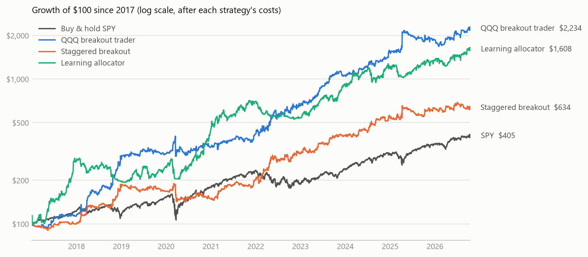

# Paper Trading Lab

An automated trading system that runs three strategies on Alpaca paper-trading accounts, each
funded with $1,000 of simulated money. The bots trade on their own every market day, log every
decision, and publish a dashboard that rebuilds itself from the live accounts.

**Live dashboard:** https://nmallik1029.github.io/paper-trading-lab/

## The strategies

| Strategy | What it trades | When it trades |
|---|---|---|
| **QQQ breakout trader** | TQQQ when QQQ breaks above its normal intraday range, SQQQ when it breaks below. Exits on a trailing stop at the range or VWAP and is flat by the close. | Every 30 minutes, 10:00 to 15:30 ET |
| **Staggered breakout portfolio** | The same rule on the Nasdaq-100, the S&P 500 and the semiconductor index (TQQQ/SQQQ, UPRO/SPXU, SOXL/SOXS), each on three half-hour clocks offset by ten minutes: nine independent slices, about 16 trades a day. | Every 10 minutes, 10:00 to 15:50 ET |
| **Learning allocator** | Five daily strategies (Bitcoin trend, short volatility timed by the VIX curve, overnight TQQQ in uptrends, RSI(2) dip buying, volatility-targeted 3x trend). The Hedge online-learning algorithm sets each one's share of the account. | Daily at 15:40 ET, plus selling the overnight position at the open |

The intraday rule comes from Zarattini, Aziz and Barbon, *Beat the Market: An Effective Intraday
Momentum Strategy for S&P500 ETF (SPY)* (2024). The daily strategies draw on published work on
volatility-managed portfolios, the overnight return premium, VIX term structure and crypto
trend-following; the full list of sources is in the [research write-up](https://nmallik1029.github.io/paper-trading-lab/reports/research.html).

## How strategies are chosen

Each idea is rebuilt and tested on this project's own data, with trading costs included: 3 basis
points per ETF trade in the daily tests, half of a one-cent spread plus slippage for the intraday
leveraged funds, and 0.30% for Bitcoin. Design decisions are made on an earlier stretch of history,
and each strategy is then evaluated once on later years it was never tuned to.

Every variant ever tested is recorded in `experiments.csv`, including the failures. The t-statistic
needed to call a result significant uses a Šidák correction, so the bar rises with each attempt.
Thirty variants have been tested so far and none clears it, which is why the results below are
treated as evidence rather than proof.

Before going live, past trading days were replayed through the live trading code on a simulated
clock (`rehearse.py`) and compared with the backtest. More than 99% of decisions matched.

## Backtest results

| Strategy | Design period | Return per year | Unseen period | Return per year | Worst drop (unseen) |
|---|---|---|---|---|---|
| QQQ breakout trader | 2017–2022 | 37% | 2023–2026 | 38% | 23% |
| Staggered breakout portfolio | 2017–2022 | 21% | 2023–2026 | 21% | 16% |
| Learning allocator | 2012–2017 | 58% | 2018–2026 | 23% | 32% |
| S&P 500 (SPY), for comparison | 2012–2017 | 15% | 2018–2026 | 15% | 34% |



Ideas that were tested and dropped include the opening-range breakout (profitable in its paper but
not after realistic costs), checking the breakout every five minutes, five-minute VWAP strategies,
the breakout on small caps, Treasuries, banks and energy, and the turn-of-the-month effect. An
earlier version of the project tested sector momentum and machine-learning models; that work is in
`archive/v1`.

## How it runs

```
cron-job.org ──> GitHub Actions ──> live.py ──> Alpaca paper accounts
                                       │
                                       └──> logs/*.jsonl (committed) ──> dashboard.py ──> GitHub Pages
```

GitHub's own scheduler can start jobs hours late, so cron-job.org calls GitHub's API at fixed
times instead:

| Time (ET, weekdays) | Workflow | What happens |
|---|---|---|
| 9:20 | `daytrader.yml` (morning) | Sell the learning allocator's overnight TQQQ at the open; run both intraday strategies until 13:10 |
| 13:05 | `daytrader.yml` (afternoon) | Run both intraday strategies from 13:20; rebalance the learning allocator at 15:40; sell everything at 15:57 |
| 15:40 | `monthly.yml` | Backup trigger for the daily rebalance; does nothing if it already happened |
| :50 past each hour, 10–16 | `dashboard.yml` | Rebuild the dashboard; restart the intraday session if it has stopped making decisions; close any intraday position a failed session left open |

The trading job also requests a dashboard rebuild every 30 minutes. Only one trading job can run
at a time, and each run checks the logs first, so a duplicate trigger never trades twice. A slow or
rejected order is logged and skipped rather than stopping a run, and if a session stops making
decisions during market hours, the hourly dashboard job starts it again.

## Repository layout

| Path | Contents |
|---|---|
| `live.py` | Live trading: both intraday strategies, the daily rebalance, the overnight unwind, safety close-outs |
| `dashboard.py` | Builds the dashboard from the accounts and logs |
| `intraday_v2.py` | Intraday strategies on five-minute bars: the breakout rule, its staggered and multi-market versions, and the rejected alternatives |
| `sleeves.py`, `allocators.py` | The five daily strategies, and equal-weight, risk-parity and Hedge allocation |
| `research_v2.py`, `research_multi.py`, `research_staggered.py`, `run_v2_report.py` | Backtests and the research write-up |
| `rehearse.py` | Replays a past trading day through the live code and compares it with the backtest |
| `tests/` | Checks for the live bot's failure handling, run against a fake broker |
| `backtest.py`, `metrics.py`, `scorecard.py`, `report.py` | Backtest engine, statistics, significance checks, report pages |
| `universe.py`, `intraday_data.py`, `broker.py` | Market data and Alpaca connections |
| `logs/` | Every decision and trade the bots have made |
| `report/` | Backtest results, the research write-up and the data behind the dashboard |
| `archive/v1/` | The first version: baseline strategies and machine-learning models, with their reports |

## Running it yourself

```
python -m venv .venv
.venv\Scripts\python -m pip install -r requirements.txt
copy .env.example .env        # then add your Alpaca paper-trading keys
.venv\Scripts\python research_staggered.py        # a backtest
.venv\Scripts\python rehearse.py 2026-10-08       # replay a past day through the live code
.venv\Scripts\python live.py daily --dry-run      # show the trades the daily rebalance would make
.venv\Scripts\python dashboard.py                 # build the dashboard into site/
```

Dry runs write to `logs_dryrun/` and never touch the real logs. API keys stay in `.env` locally
and in the repository's GitHub secrets.

---

Simulated money only. Nothing here is investment advice, and backtest results are not a forecast.
